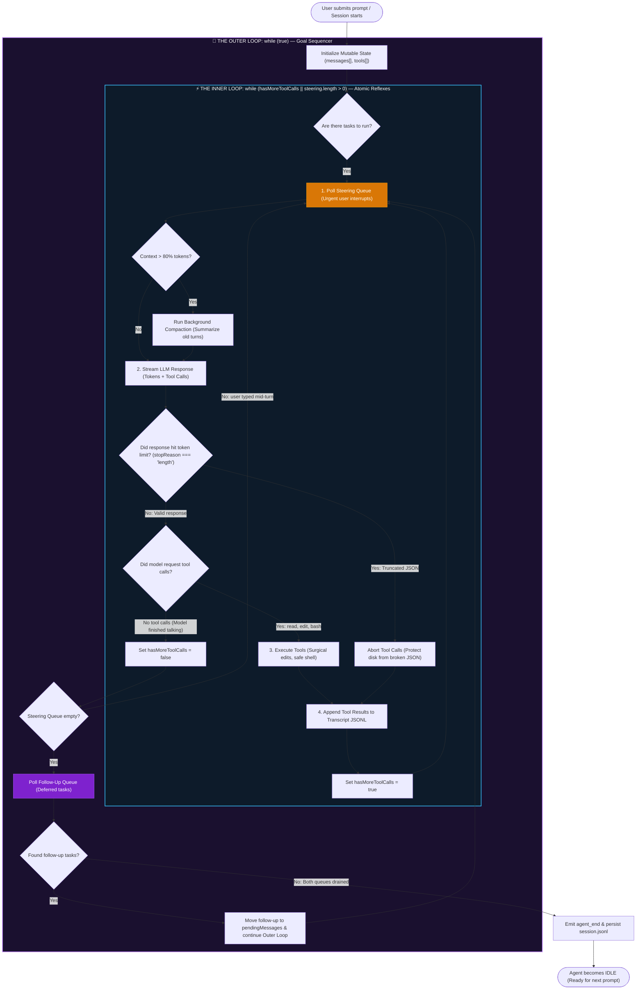
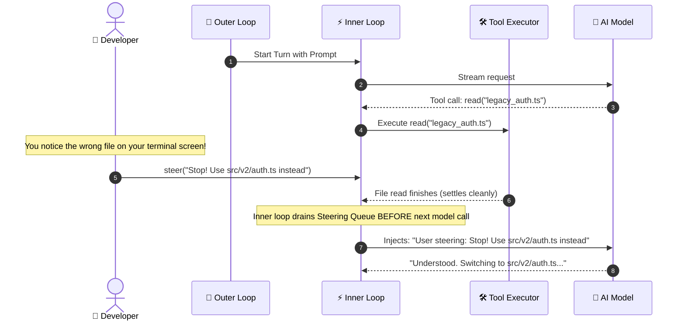

# 🔄 The Complete Inner Loop & Outer Loop Workflow

> A step-by-step, mechanical breakdown of how production coding agents (like Pi) coordinate the **Reflex Engine (Inner Loop)** and the **Goal Sequencer (Outer Loop)**.

---

## 🏗️ 1. High-Level Architecture Flowchart



---

## 🔬 2. Step-by-Step Execution Lifecycle

Let's trace what happens when you give an agent a task:
> *"Fix the authentication bug in `auth.ts`, and when you're done, run the integration test suite."*

Here is the exact lifecycle across both loops:

### 📍 Phase A: Session Ingestion & Setup
1. **User input arrives:**
   * Immediate task: *"Fix the authentication bug in `auth.ts`"* (enters **pendingMessages**).
   * Deferred task: *"Run integration test suite"* (enters **followUpQueue**).
2. **System Prompt Assembled:** Behavioral rules + available tools (`read`, `edit`, `bash`) + project directory context.
3. **The Outer Loop begins:** `while (true)`.

---

### 📍 Phase B: The Inner Loop (Atomic Reflexes)
The inner loop evaluates: `while (hasMoreToolCalls || pendingMessages.length > 0)`.

#### Cycle 1: Inspection
* **Step 1 (Steering Poll):** Checks if the user typed an urgent mid-flight correction. (None found).
* **Step 2 (LLM Stream):** Model receives transcript. It outputs:
  ```json
  "tool_calls": [{ "name": "read", "arguments": { "path": "src/auth.ts" } }]
  ```
* **Step 3 (Tool Execution):** The tool executor reads `auth.ts` line-by-line from disk.
* **Step 4 (Append Result):** The file contents are pushed into `messages[]`.
* **State Check:** `hasMoreToolCalls = true`. The inner loop repeats immediately!

#### Cycle 2: The Surgical Fix
* **Step 1 (Steering Poll):** No interruption.
* **Step 2 (LLM Stream):** Model reads the file contents from context and outputs:
  ```json
  "tool_calls": [{ "name": "edit", "arguments": { "path": "src/auth.ts", "target": "token.exp < now", "replacement": "token.exp <= now" } }]
  ```
* **Step 3 (Tool Execution):** Pi verifies the exact target text on disk, performs the atomic replacement, and saves the file.
* **Step 4 (Append Result):** Pushes `"Edit applied successfully"` to `messages[]`.
* **State Check:** `hasMoreToolCalls = true`. The inner loop repeats!

#### Cycle 3: The Completion Response
* **Step 1 (Steering Poll):** No interruption.
* **Step 2 (LLM Stream):** The model sees the edit succeeded. It outputs plain text:
  > *"I have fixed the token expiration comparison in `auth.ts`."*
* **Step 3 (Tool Inspection):** No tool calls requested!
* **State Check:** `hasMoreToolCalls = false` AND `pendingMessages.length === 0`.
* **Exit:** **The Inner Loop terminates.**

---

### 📍 Phase C: The Outer Loop Handoff
Now that the inner loop has put its tools down:

1. The outer loop wakes up.
2. It polls the **Follow-Up Queue**:
   * It finds the queued task: *"Run integration test suite"*.
3. The outer loop moves that task into `pendingMessages`.
4. It calls `continue` on the outer loop!
5. **The Inner Loop boots up again:**
   * It calls the model with *"Run integration test suite"*.
   * The model invokes `bash("npm test")`.
   * Tool runs tests ➔ outputs results ➔ model summarizes pass/fail.

---

### 📍 Phase D: Quiescence (Going to Sleep)
1. The inner loop finishes the test summary.
2. The outer loop polls the **Follow-Up Queue** again ➔ **Empty!**
3. Both loops terminate.
4. Pi flushes the final `.jsonl` transcript to disk and returns terminal control to you.

---

## ⚡ 3. The Human Interruption: How `steer()` Intercepts

What if you notice the model reading the wrong file in Cycle 1?



---

## 📊 4. Comparison Summary: Inner vs. Outer Loop

| Feature | The Inner Loop | The Outer Loop |
|---|---|---|
| **Loop Condition** | `while (hasMoreToolCalls \|\| pendingMessages.length > 0)` | `while (true)` |
| **Responsibility** | Immediate atomic reflexes (read, edit, execute) | Long-horizon project and follow-up sequencing |
| **Queue Checked** | **Steering Queue** (`steer()`) — Immediate priority | **Follow-Up Queue** (`followUp()`) — Deferred |
| **When it runs** | Between individual tool calls and model responses | Only after all tool calls settle and the model stops |
| **Failure Handling** | Catches broken tools, token truncations, and syntax errors | Decides whether to continue multi-step jobs or halt |
| **Real-Life Analogy** | The **Carpenter** actively cutting wood at the bench | The **Foreman** holding the job site checklist |
