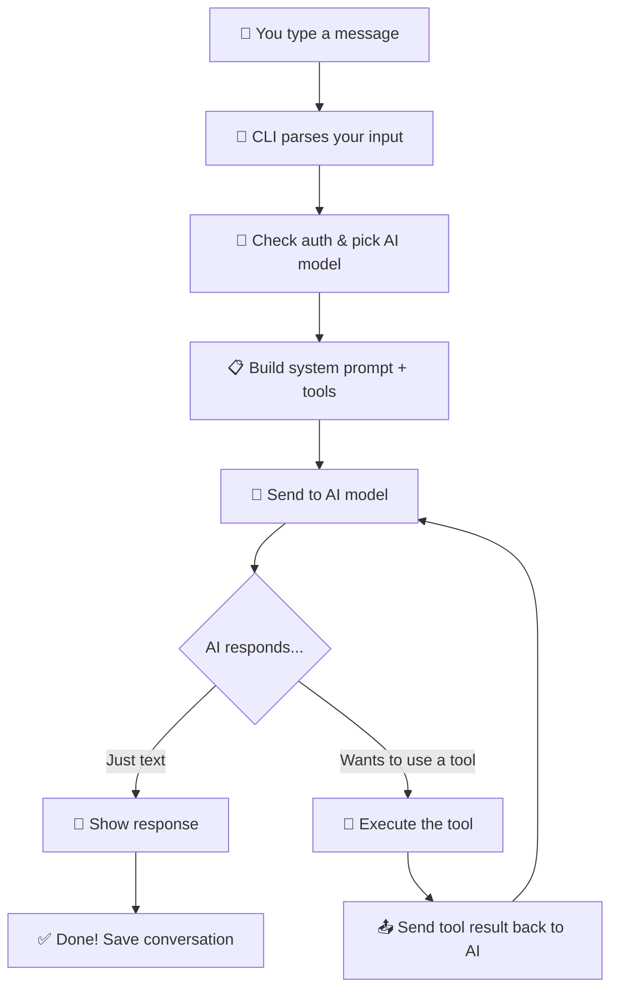

# 🏗️ Pi Agent — The Big Picture

## What is Pi?

Imagine you hired a **very smart assistant** who sits inside your terminal (command line). You tell it:
> "Hey, fix the login bug in my app"

And it goes off, reads your code, edits files, runs commands, and comes back with the fix. That's **Pi**.

Pi is an **AI coding agent** — a program that talks to AI models (like Claude, GPT, Gemini) and uses **tools** (read files, write files, run terminal commands) to do real work on your computer.

---

## The Restaurant Analogy 🍽️

Think of Pi as a **restaurant**. Here's how each part maps:

| Restaurant | Pi Agent | What it does |
|---|---|---|
| 🧑‍🍳 **Head Chef** | `pi-agent-core` | The brain — decides what to cook (what actions to take) |
| 📋 **Menu** | `pi-ai` | Lists all the dishes (AI models) from different suppliers |
| 🍳 **Kitchen Tools** | `tools/` (read, write, bash, edit) | The actual knives, pans, ovens (file operations, shell commands) |
| 🪑 **Dining Room** | `pi-tui` | The pretty terminal interface you see |
| 📦 **Storage Room** | `pi-durable` | Saves conversations so you can come back later |
| 🔌 **Power Supply** | `chord` | The wiring that connects everything together |
| 📊 **Health Inspector** | `pi-telemetry` | Tracks how things are going (metrics, logging) |
| 🎨 **Interior Designer** | `coding-agent` (modes, extensions) | Customizations — themes, skills, plugins |

---

## How Pi Handles Your Request (Step by Step)



> [!TIP]
> The key insight: Pi is a **loop**. The AI talks, uses tools, gets results, talks again — until the job is done. It's like a chef tasting their dish, adjusting seasoning, tasting again.

---

## The 7 Packages (Modules)

Pi is a **monorepo** — one big folder containing 7 separate packages that work together:

```
pi/
├── packages/
│   ├── chord/         ← 🔌 Plugin system & communication
│   ├── telemetry/     ← 📊 Logging & metrics
│   ├── ai/            ← 📋 Talk to AI models (OpenAI, Anthropic, Google)
│   ├── durable/       ← 📦 Save & resume conversations
│   ├── agent/         ← 🧑‍🍳 The brain (agent loop)
│   ├── coding-agent/  ← 🎯 The actual CLI app you use
│   └── tui/           ← 🪑 Terminal UI (colors, layouts)
```

> [!IMPORTANT]
> Each package is **independent** but they stack on each other like building blocks. `ai` doesn't care about `coding-agent`, but `coding-agent` uses everything below it.

---

## What Makes Pi Special?

1. **No built-in permissions** — Pi runs with YOUR permissions. It can do anything you can do on your machine.
2. **Extensible** — Add your own tools, skills, themes, and extensions.
3. **Multiple AI providers** — Switch between OpenAI, Anthropic, Google, etc.
4. **Session management** — Resume, fork, and branch conversations.
5. **Multiple modes** — Interactive (terminal), Print (scripting), RPC (API), JSON (automation).

---

*Next: Let's dive deep into each package, starting with the brain — the Agent Loop →*
