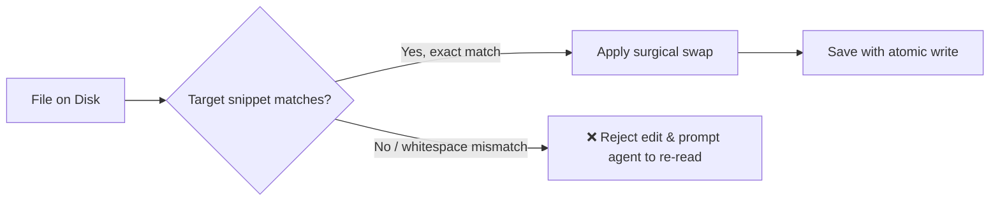

# 🛠️ Module 3: Tools, Filesystem & Prompt Assembly

In this module, we examine how Pi touches the real world: reading/writing files, running terminal commands, and how it constructs the instructions (system prompts) that keep the AI on track.

---

## 1. The Built-in Tool Arsenal 🧰

Pi ships with focused, specialized tools designed to minimize hallucination and prevent accidental damage:

| Tool | Purpose | Real-World Analogy |
|---|---|---|
| **`read`** | Reads files with byte offsets, line numbering, and image support. | Putting on glasses to inspect a blueprint line by line. |
| **`edit`** | Performs precise targeted text replacements using exact string matching. | A surgeon with a scalpel: cuts only the exact target text. |
| **`write`** | Creates or overwrites complete files. | Laying down a whole new sheet of paper. |
| **`bash`** / **`powershell`** | Executes terminal commands with timeout handling and background execution. | Sending a runner to execute commands in the garage/workshop. |
| **`grep`** & **`find`** | Fast regex search across files and directory tree lookups. | Using an index catalog in an enormous library. |
| **`ls`** | Directory listing with file metadata and sizes. | Scanning the table of contents. |

---

## 2. Safe Editing: Why not just rewrite the whole file?

When AI rewrites a 1,000-line file, it often forgets functions, loses comments, or introduces subtle syntax errors.

Pi solves this with **strict surgical edits** ([edit.ts](file:///C:/Users/adi/CODING_AGENT_DECODE/pi/packages/coding-agent/src/core/tools/edit.ts)):
1. The AI must supply the **exact snippet** (`target`) that currently exists in the file.
2. The AI provides the **replacement snippet**.
3. If the target snippet is ambiguous or doesn't match character-for-character (including indentation), Pi **rejects the edit** and tells the model to re-read.



---

## 3. How the System Prompt is Assembled 🧩

The AI model doesn't just receive your message; it receives an entire dossier assembled by [system-prompt.ts](file:///C:/Users/adi/CODING_AGENT_DECODE/pi/packages/coding-agent/src/core/system-prompt.ts):

```
┌────────────────────────────────────────────────────────┐
│ 1. Preamble & Behavioral Rules                         │
│    "You are Pi, an expert AI coding assistant..."      │
├────────────────────────────────────────────────────────┤
│ 2. Tool Declarations & Guidelines                      │
│    Exact schema of read, edit, write, bash + rules     │
├────────────────────────────────────────────────────────┤
│ 3. Project Context Files                               │
│    Reads AGENTS.md, README.md, context rules in repo   │
├────────────────────────────────────────────────────────┤
│ 4. Active Skills & Extensions                          │
│    Summaries of any installed skill packages           │
├────────────────────────────────────────────────────────┤
│ 5. Environment & Workspace Metadata                    │
│    Current OS (Windows), cwd, shell (powershell)       │
└────────────────────────────────────────────────────────┘
```

Everything is section-tagged (like `<system-guidelines>...</system-guidelines>`), allowing the agent to distinguish system boundaries from user input.
